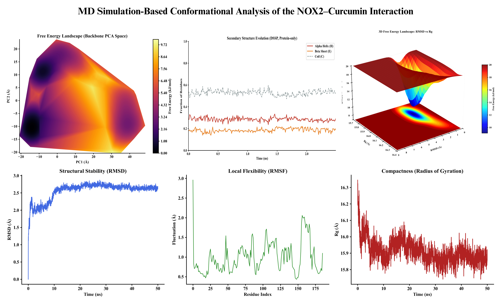
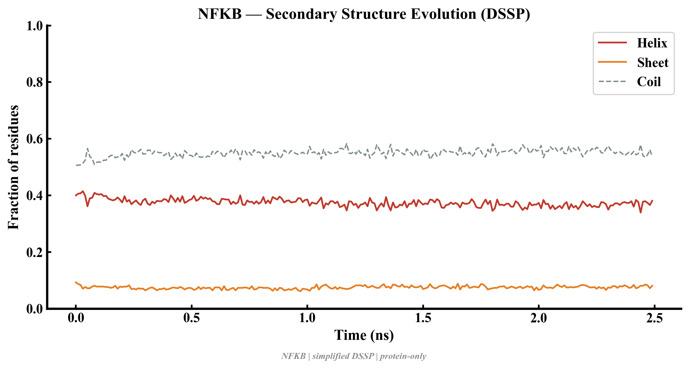
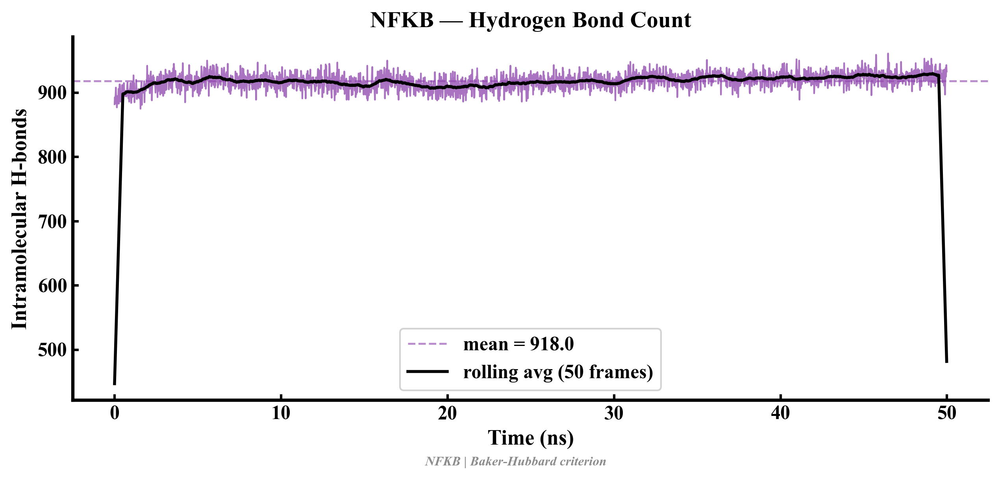
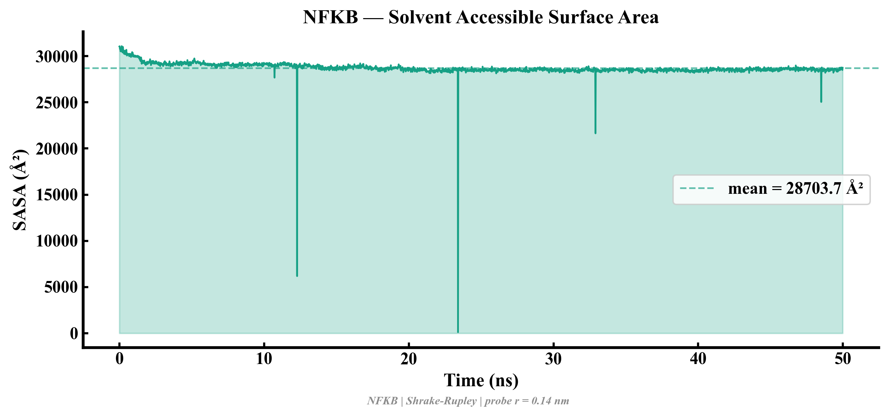
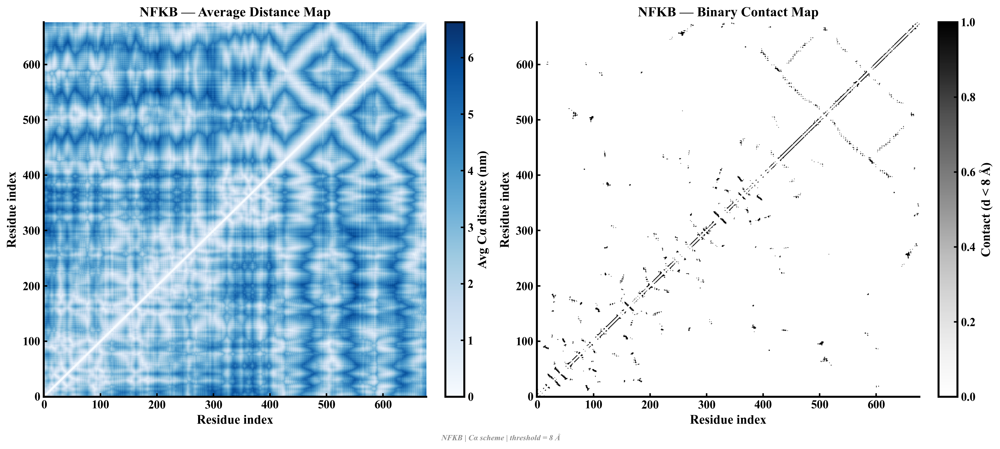
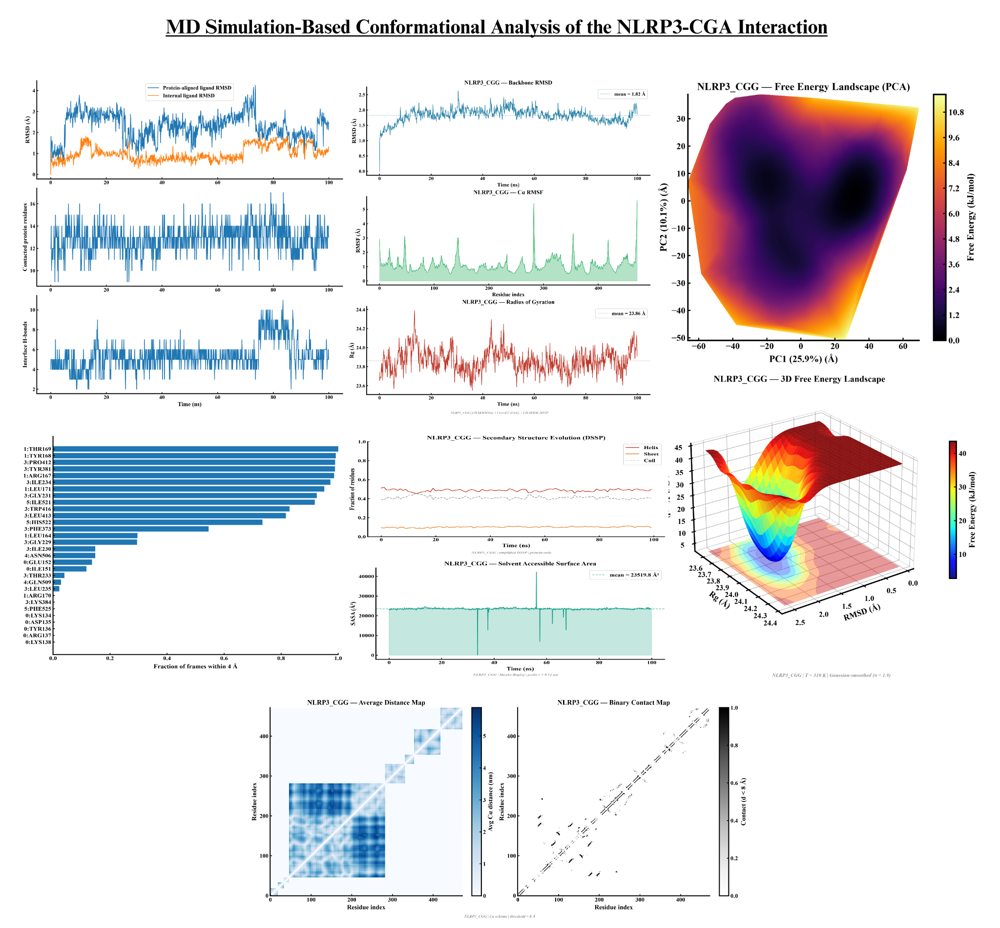

# MD Toolkit

[](https://www.python.org/downloads/)
[](https://opensource.org/licenses/MIT)
[](https://github.com/psf/black)

An end-to-end toolkit for running molecular dynamics simulations and analyzing the resulting trajectories.



---

## Features

### Simulation Engine (`simulate.py`)
- **OpenMM-based MD runner** — reads YAML configuration and executes full simulation pipelines
- **Flexible system setup** — supports PDB inputs, force fields (AMBER14, CHARMM36), and explicit solvent
- **Configurable protocols** — energy minimization, NVT/NPT equilibration, and production runs
- **Automated output** — writes trajectories in DCD format with configurable reporters

### Analysis Suite (`analyses.py`)

The analysis module provides eight core analysis functions, each paired with a dedicated plotting routine:

#### 1. Structural Stability
- **RMSD** (Root Mean Square Deviation) — backbone alignment against reference structure
- **RMSF** (Root Mean Square Fluctuation) — per-residue flexibility (Cα atoms)
- **Rg** (Radius of Gyration) — global compactness metric

```python
data = compute_rmsd_rmsf_rg(traj, dt_ps=20.0, plot_unit="A")
plot_rmsd_rmsf_rg(data, outdir="output", protein="NFKB")
```
**Output:** `MD_Analysis_Summary.png` — three-panel figure (RMSD vs time, RMSF per residue, Rg vs time)

---

#### 2. Principal Component Analysis (PCA)
- Dimensionality reduction on backbone coordinates
- Explained variance quantification
- PC space trajectory projection

```python
pca_data = compute_pca(traj, dt_ps=20.0, n_components=2, random_state=0)
plot_pca_fel(pca_data, outdir="output", protein="NFKB", T_K=310.0)
```
**Outputs:**
- `FEL_PCA_Backbone.png` — Free energy landscape in PC1–PC2 space (KDE-based)
- `PCA_scatter_time.png` — PC trajectory colored by simulation time

**Algorithm:**
- Flattens backbone coordinates into feature vectors
- Applies `sklearn.decomposition.PCA`
- Prints explained variance for top components

---

#### 3. Free Energy Landscape (RMSD vs Rg)
- 2D/3D free energy surfaces from RMSD and radius of gyration
- Histogram-based density estimation with Gaussian smoothing
- Thermodynamic weighting: ΔG = -kB T ln(P)

```python
rmsd = data["rmsd"]
rg = data["rg"]
fel = build_fel_rmsd_rg(rmsd, rg, bins=30, sigma=1.9, T_K=310.0)
plot_fel_2d(fel, outdir="output", protein="NFKB")
plot_fel_3d(fel, outdir="output", protein="NFKB")
```
**Outputs:**
- `FEL_RMSD_RG_2D.png` — contour map
- `FEL_RMSD_RG_3D.png` — surface plot

---

#### 4. Secondary Structure (DSSP)
- Per-residue assignment using simplified DSSP algorithm
- Time evolution of helix, sheet, and coil fractions
- Configurable stride for computational efficiency

```python
dssp = compute_dssp(traj, stride=10, dt_ps=20.0)
plot_dssp(dssp, outdir="output", protein="NFKB")
```
**Output:** `DSSP_SecondaryStructure_Fractions.png`




**Implementation:**
- Uses `mdtraj.compute_dssp(simplified=True)`
- Classifies into three states: `H` (helix), `E` (sheet), `C` (coil)

---

#### 5. Hydrogen Bond Analysis
- Frame-by-frame H-bond counting using **Baker-Hubbard criterion**
- Persistent bond identification with occupancy thresholds
- Donor–acceptor residue pair tracking

```python
hbonds = compute_hbonds(traj, dt_ps=20.0, freq_threshold=0.3)
plot_hbonds(hbonds, outdir="output", protein="NFKB")
```
**Output:** `HBonds_Count_Time.png` — H-bond count vs time with rolling average



**Note:** This analysis is computationally intensive for large trajectories due to per-frame geometry checks.

---

#### 6. Solvent-Accessible Surface Area (SASA)
- Per-frame SASA calculation using Shrake-Rupley algorithm
- Unit-aware output (Ångström² or nm²)

```python
sasa = compute_sasa(traj, dt_ps=20.0, pl_unit="A")
plot_sasa(sasa, outdir="output", protein="NFKB")
```
**Output:**
 `SASA_Time.png`



---

#### 7. Residue Contact Maps
- Mean inter-residue distance matrix calculation
- Contact probability mapping

```python
contacts = compute_contact_map(traj, selection="protein")
plot_contact_map(contacts, outdir="output", protein="NFKB")
```

**Output:** `Contact_Map.png`



---

## Installation

1. Clone the repository:
```bash
git clone https://github.com/username/mdtoolkit.git
cd mdtoolkit
```

2. Create and activate a conda environment:
```bash
conda create -n md-env python=3.9 -y
conda activate md-env
conda install -c conda-forge openmm mdtraj pandas numpy pyyaml scikit-learn matplotlib
```

---

## Usage

### 1. Configuration
Modify `config/config.yaml` to specify your force field, input PDB, and simulation parameters.

### 2. Run Simulation
```bash
python simulate.py --config config/config.yaml
```

### 3. Run Analysis
```bash
python -m src.analyses --config config/config.yaml --traj data/trajectory.dcd --top data/topology.pdb
```

---

## Development

The toolkit follows a modular "Compute vs Plot" design:
- `analyses.py`: Analytical engines returning dictionary-based results
- `plotting.py`: Centralized styling and visualization layer
- `simulate.py`: OpenMM pipeline management

Figures are automatically generated with scientific captions including protein name, temperature, and force field metadata.

---

## Protein–Ligand Interaction Analysis

In addition to the protein-centered analyses described above, `analyses.py` includes an automated **protein–ligand interaction analysis** for simulations with a configured ligand residue. This workflow uses the full trajectory (protein and ligand), aligned on the protein Cα atoms, to assess ligand positional stability, internal conformational changes, residue contacts, and intermolecular hydrogen bonds. The analysis is launched automatically by `run_analysis()` when the configuration contains a `ligand` section.

### Ligand RMSD and Conformational Stability

Two complementary heavy-atom RMSD metrics are evaluated relative to the first analyzed frame:

- **Protein-aligned ligand RMSD:** Ligand displacement measured after aligning the full trajectory on the protein Cα atoms. It reflects ligand movement relative to the protein together with ligand conformational changes.
- **Internal ligand RMSD:** RMSD calculated after separately superposing the ligand heavy atoms on their reference coordinates. It emphasizes changes in the ligand's internal conformation rather than its overall displacement in the binding site.

Together, these metrics help distinguish movement of the ligand within or away from its initial binding pose from internal conformational rearrangement. RMSD alone does not establish binding affinity or ligand dissociation.

### Protein–Ligand Residue Contacts

For each analyzed frame, the script calculates the distances between ligand heavy atoms and protein heavy atoms. A protein residue is considered in contact when at least one of its heavy atoms is within the configured cutoff of any ligand heavy atom.

- **Default contact cutoff:** `0.4 nm` (4 Å), configurable through `analysis.ligand_contact_cutoff_nm`.
- **Contact count:** Number of distinct protein residues contacting the ligand in each frame.
- **Contact occupancy:** Fraction of analyzed frames in which a given protein residue contacts the ligand, ranging from 0 to 1.
- **Residue ranking:** The 30 residues with the highest contact occupancy are displayed in a horizontal bar chart.

Contact occupancy helps characterize persistent versus transient protein–ligand proximity; it is not a direct measurement of interaction energy.

### Intermolecular Hydrogen Bonds

Candidate hydrogen bonds are identified with MDTraj's Baker–Hubbard method, retaining only interactions across the protein–ligand interface (one partner on the protein and the other on the ligand). The implementation evaluates candidate donor–hydrogen–acceptor triples across the analyzed trajectory using:

- **Hydrogen–acceptor distance:** less than `0.25 nm` (2.5 Å).
- **Donor–hydrogen–acceptor angle:** greater than `120°`.
- **H-bond count:** Number of detected protein–ligand hydrogen bonds in each analyzed frame.
- **H-bond occupancy:** Fraction of analyzed frames in which each detected hydrogen bond meets the geometric criteria.

These values provide geometric evidence of intermolecular hydrogen-bond persistence; they should not be interpreted as direct binding free energies.

### Configuration and Execution

The ligand is identified using `ligand.residue_name` in the YAML configuration. The additional ligand analysis uses the following optional analysis settings:

```yaml
ligand:
  residue_name: CGA  # Example only; must match the actual topology residue name

analysis:
  ligand_stride: 1
  ligand_contact_cutoff_nm: 0.4
```

`ligand_stride` controls the frame-sampling interval (default: 1, meaning every trajectory frame). These settings are used alongside the existing simulation and analysis configuration; the snippet is not intended as a complete configuration file.

Run the analysis using the same command described above:

```bash
python -m src.analyses --config config/config.yaml --traj data/trajectory.dcd --top data/topology.pdb
```

The topology must include the ligand and match the trajectory. The script verifies the presence of exactly one residue with the configured ligand name before performing this analysis.

### Ligand Analysis Outputs

The following files are automatically saved under `<output_dir>/ligand_analysis/`:

| Output file | Description |
| --- | --- |
| `ligand_stability.png` | Three-panel time series of protein-aligned ligand RMSD, internal ligand RMSD, contacting residue count, and protein–ligand hydrogen-bond count (the first panel contains both RMSD curves). |
| `ligand_contact_occupancy.png` | Top 30 protein residues ranked by fraction of analyzed frames in contact with the ligand. |
| `timeseries.csv` | Per-frame time, both ligand RMSD metrics, contacting residue counts, and interface hydrogen-bond counts. |
| `contact_occupancy.csv` | Protein residue identities, contact-occupancy fractions, and distance cutoff. |
| `hbond_occupancy.csv` | Donor and acceptor identities and their hydrogen-bond occupancy fractions. |

### Example: NLRP3–CGA Molecular Dynamics Analysis

The following composite figure illustrates a 100 ns NLRP3–CGA trajectory analysis, combining protein-centered structural and conformational measures with ligand-focused interaction metrics. It includes protein-aligned and internal ligand RMSD, interfacial contact and hydrogen-bond counts, ranked contact occupancies, backbone RMSD, Cα RMSF, radius of gyration, secondary-structure evolution, solvent-accessible surface area, principal-component free-energy landscape, RMSD–Rg free-energy landscape, and protein residue contact maps.

**Interpretation:** The ligand RMSD curves describe positional and internal stability, whereas contact occupancies and hydrogen-bond counts characterize the persistence of geometric contacts at the protein–ligand interface. Protein structural metrics and projected free-energy landscapes provide complementary descriptions of sampled conformations. The landscapes are relative, distribution-derived free-energy representations, not direct estimates of ligand binding free energy.



*Figure. MD simulation-based conformational and protein–ligand interaction analysis of the NLRP3–CGA complex, including structural stability, contact persistence, secondary-structure dynamics, and projected free-energy landscapes.*
